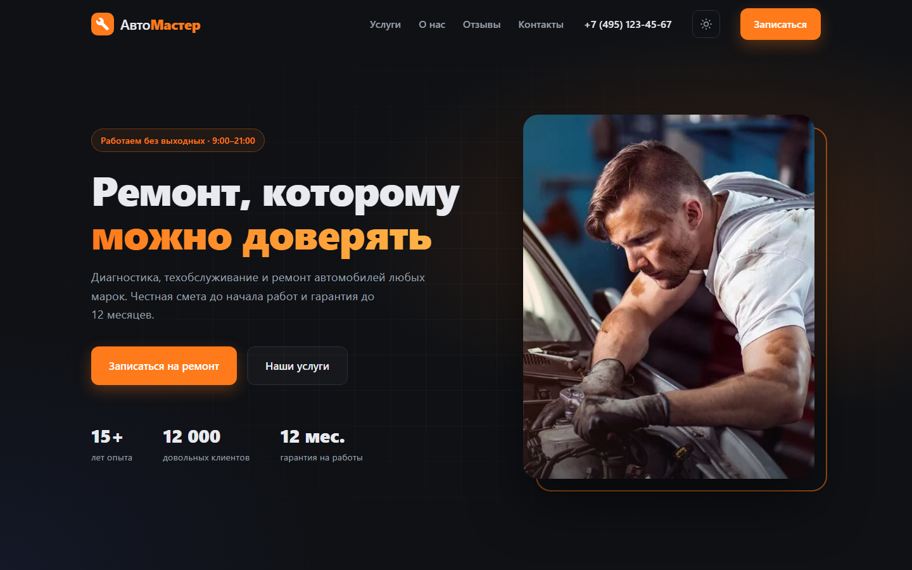

# АвтоМастер

Лендинг автосервиса — демонстрационный проект.

**Сайт:** https://risaber.github.io/AutoProject/



## Назначение

Учебный лендинг вымышленного автосервиса: показать вёрстку, адаптивность и клиентскую логику без серверной части.

> Автосервиса не существует. Отзывы, статистика («15+ лет», «12 000 клиентов»), адрес, телефон и почта вымышлены — на сайте это отмечено.

## Возможности

- Разделы: первый экран, услуги с ценами, преимущества, отзывы, контакты с декоративной схемой проезда (это иллюстрация на CSS, а не интерактивная карта).
- Адаптивная вёрстка, проверена на ширинах 320, 375, 768, 1024 и 1440px.
- Светлая и тёмная тема; выбор сохраняется в `localStorage`.
- Мобильное меню (бургер) и подсветка пункта меню текущего раздела при прокрутке.
- Демо-форма записи в модальном окне:
	- маска телефона и проверка полей в браузере;
	- услуга подставляется из карточки, по которой открыли форму;
	- **данные никуда не отправляются и не сохраняются** — после проверки форма показывает, что это демонстрация.
- Доступность:
	- семантичная разметка, подписи у полей, сообщения об ошибках связаны с полями (`aria-describedby`, `aria-invalid`);
	- модальное окно: фокус удерживается внутри, фон недоступен (`inert`), закрытие по Escape с возвратом фокуса;
	- мобильное меню закрывается по Escape;
	- учёт `prefers-reduced-motion`.

## Технологии

- HTML5
- CSS3 — CSS-переменные, Grid, Flexbox, именование по BEM
- JavaScript без библиотек и фреймворков

## Структура

```
index.html          — разметка страницы
css/style.css       — основные стили
css/responsive.css  — адаптивность (медиазапросы)
js/main.js          — меню, шапка, тема, модалка записи
images/             — изображения
screenshots/        — скриншоты для README
```

## Запуск

Сборка не нужна — достаточно открыть `index.html` в браузере.
